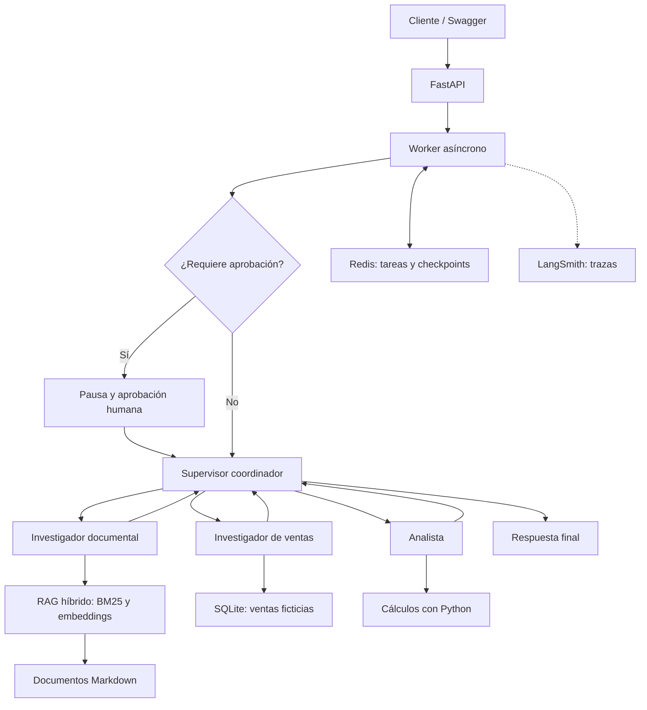

# Ca’Lu — Asistente multiagente con RAG y API asíncrona

Proyecto final de AI Engineering que integra consultas documentales y análisis de ventas ficticias mediante agentes coordinados con LangGraph.

La API permite crear tareas, consultar su estado y aprobar su continuación. Incluye recuperación híbrida de documentos, validación de cálculos con Python, checkpoints en Redis y trazas en LangSmith.

## Alcance

El asistente puede:

- Consultar catálogo, materiales, cuidados y requisitos para presupuestos.
- Recuperar ventas históricas ficticias desde SQLite.
- Calcular facturación por producto, unidades totales y producto con mayores ingresos.
- Combinar información documental y análisis de ventas.
- Informar cuando los documentos no permiten responder una consulta.
- Pausar tareas para aprobación humana y reanudarlas después de reiniciar la API.

Los documentos y las ventas son datos de demostración. Los precios históricos no representan cotizaciones actuales.

El sistema no confirma pedidos, modifica precios ni ejecuta acciones comerciales externas.

## Arquitectura



### Componentes

| Componente | Responsabilidad |
|---|---|
| FastAPI | Recibir tareas y exponer estado, aprobación y salud |
| Worker | Procesar tareas en segundo plano sin bloquear la solicitud HTTP |
| Coordinador | Determinar si se necesitan documentos, ventas o ambas fuentes |
| Investigador documental | Buscar evidencia y responder con referencias a archivos |
| Investigador de ventas | Recuperar registros de la base de demostración |
| Analista | Usar la herramienta de cálculo para analizar las ventas |
| Supervisor de ventas | Revisar resultados y contrastarlos con cálculos en Python |
| Redis | Conservar registros de tareas y checkpoints de LangGraph |
| LangSmith | Registrar agentes, herramientas, llamadas al modelo y errores |

## Decisiones de diseño

### Recuperación híbrida

La búsqueda combina BM25, para coincidencias léxicas, y embeddings multilingües, para similitud semántica.

Los documentos se dividen por secciones Markdown y, cuando corresponde, por fragmentos con solapamiento. Los rankings se combinan mediante Reciprocal Rank Fusion y se aplica una bonificación por coincidencia con los encabezados.

El modelo de embeddings se configura mediante una variable de entorno y se ejecuta localmente en CPU. El índice se construye al iniciar la API y se comparte entre consultas.

El umbral semántico es configurable. La recuperación puede devolver fragmentos que no respondan directamente a una pregunta; el investigador debe reconocer esa falta de evidencia.

### Coordinación de agentes

El coordinador utiliza un esquema Pydantic para seleccionar las fuentes necesarias.

Las consultas documentales se dirigen al investigador documental. Las consultas de ventas utilizan al investigador y al analista. Las consultas mixtas recorren ambas ramas.

La respuesta mixta reúne los resúmenes de ambas ramas; puede conservar algunas repeticiones de redacción.

### Validación

Se utilizan modelos Pydantic en la API, en la planificación del coordinador, en las decisiones del supervisor y en la entrada y salida de la búsqueda documental.

Los resultados numéricos del analista se comparan con un cálculo independiente en Python antes de permitir la finalización del análisis de ventas.

La validación de estructura y de cálculos no garantiza por sí sola que toda la redacción generada sea correcta.

### Persistencia

Redis conserva los registros de tareas y los checkpoints del grafo.

Cada tarea utiliza su identificador como identificador de hilo de LangGraph. Se verificó que una tarea pausada por aprobación puede reanudarse después de reiniciar la API.

Docker Compose configura Redis con AOF y un volumen persistente.

### Observabilidad

LangSmith registra el recorrido de los agentes, las herramientas utilizadas, las entradas, las salidas y los errores.

Las capturas de las pruebas se encuentran en `screenshots/`.

## Requisitos

- Docker Desktop iniciado y Docker Compose disponible.
- Acceso a Internet para descargar imágenes, dependencias y el modelo de embeddings.
- Clave válida de Groq para las consultas al modelo.
- Clave de LangSmith para registrar las trazas.

La imagen de la API utiliza Python 3.12.

## Configuración

Copiar `.env.example` como `.env` y completar sus variables.

En PowerShell:

```powershell
Copy-Item .env.example .env
```

No sobrescribir un `.env` que ya esté configurado.

Variables principales:

| Variable | Uso |
|---|---|
| `GROQ_API_KEY` | Clave del proveedor del modelo |
| `GROQ_MODEL` | Identificador del modelo compatible con el proyecto |
| `GROQ_MAX_TOKENS` | Máximo de tokens de salida por llamada |
| `LANGSMITH_API_KEY` | Clave para enviar trazas |
| `LANGSMITH_TRACING` | Activación del tracing |
| `LANGSMITH_PROJECT` | Proyecto de LangSmith |
| `REDIS_URL` | Dirección de Redis |
| `EMBEDDING_MODEL` | Modelo de embeddings |
| `RAG_MIN_SIMILARITY` | Umbral de similitud semántica |

Configuración utilizada para las pruebas:

```dotenv
GROQ_MAX_TOKENS=768
LANGSMITH_TRACING=true
LANGSMITH_PROJECT=proyecto-final-ia-calu
EMBEDDING_MODEL=sentence-transformers/paraphrase-multilingual-MiniLM-L12-v2
RAG_MIN_SIMILARITY=0.35
```

Las claves reales se guardan únicamente en `.env`.

Docker Compose establece `REDIS_URL=redis://redis:6379/0` dentro del contenedor de la API.

## Inicio con un comando

Desde la raíz del proyecto:

```powershell
docker compose up --build -d
```

La primera ejecución puede tardar mientras se descargan las dependencias y el modelo.

Consultar el progreso:

```powershell
docker compose logs --tail=80 api
```

Esperar el mensaje:

```text
Application startup complete.
```

Direcciones locales:

- Swagger: http://127.0.0.1:8000/docs
- Salud: http://127.0.0.1:8000/health

Respuesta de salud esperada:

```json
{
  "status": "ok",
  "redis": "connected"
}
```

Estado de los contenedores:

```powershell
docker compose ps
```

Detener los servicios conservando los volúmenes:

```powershell
docker compose down
```

Iniciarlos nuevamente:

```powershell
docker compose up -d
```

## Uso de la API

### Crear una tarea

`POST /tasks`

```json
{
  "user_query": "¿Qué datos necesito para pedir un presupuesto de 25 llaveros personalizados?",
  "requires_approval": false
}
```

La API responde con HTTP 202 y un `job_id`.

### Consultar el estado

`GET /tasks/{job_id}`

Estados posibles:

- `PENDING`
- `RUNNING`
- `WAITING_APPROVAL`
- `DONE`
- `REJECTED`
- `FAILED`

La respuesta incluye el resultado final, el error si corresponde y el tiempo de ejecución registrado.

Consultar mediante GET no vuelve a ejecutar una tarea.

### Aprobar una tarea

Crear la tarea con `requires_approval: true`.

Cuando alcance `WAITING_APPROVAL`, utilizar:

`POST /tasks/{job_id}/approve`

```json
{
  "approved": true
}
```

Luego consultar el mismo identificador mediante GET.

Para rechazarla:

```json
{
  "approved": false
}
```

## Documentos

Los archivos se encuentran en `data/documents/`:

- `catalogo.md`: productos y posibilidades de personalización.
- `materiales.md`: materiales y cuidados.
- `pedidos.md`: información necesaria para presupuestos y entregas.

Después de modificar documentos, reconstruir la imagen y recrear la API:

```powershell
docker compose up --build -d
```

## Datos ficticios de ventas

| Producto | Unidades | Precio histórico unitario | Facturación |
|---|---:|---:|---:|
| Llaveros | 50 | ARS 1.300 | ARS 65.000 |
| Miniaturas | 12 | ARS 4.500 | ARS 54.000 |
| Dummys | 8 | ARS 6.500 | ARS 52.000 |
| **Total** | **70** | — | **ARS 171.000** |

Estos valores son datos de demostración.

La facturación representa ingresos por ventas. Sin datos de costos no se puede calcular la ganancia.

## Pruebas manuales realizadas

| Caso | Comprobación |
|---|---|
| Presupuesto documental | Respuesta sobre requisitos con referencias a los documentos |
| Análisis de ventas | Facturación total de ARS 171.000 y llaveros como producto líder |
| Consulta mixta | ARS 65.000 históricos de llaveros y requisitos para un presupuesto nuevo |
| Consulta sin evidencia | Reconocimiento de falta de información sobre un supuesto satélite |
| Aprobación y reinicio | Pausa, reinicio de la API y reanudación de la misma tarea tras aprobarla |

Se revisaron las trazas de los cinco casos en LangSmith.

También se verificaron dentro de Docker:

- Inicio de API y Redis.
- Respuesta de `/health` con Redis conectado.
- Consulta documental sobre cuidados del PLA, finalizada sin error y con fuente.

Las capturas documentan ejecuciones puntuales; no constituyen una evaluación exhaustiva de calidad.

## Dependencias

`requirements.txt` contiene las dependencias principales.

Si se generó `requirements.lock.txt`, contiene las versiones instaladas en el contenedor probado. El Dockerfile actual instala desde `requirements.txt`; el archivo de versiones queda como referencia del entorno de validación.

## Limitaciones y mejoras pendientes

- Las llamadas a Groq dependen de conectividad y de las cuotas disponibles.
- Se observaron errores de límite de uso y respuestas cortadas durante el desarrollo.
- Se redujo el máximo de salida y se ajustaron las instrucciones para obtener respuestas más breves.
- La cola del worker reside en memoria: no se garantiza la recuperación automática de tareas pendientes o en ejecución tras una interrupción.
- La persistencia comprobada corresponde a tareas pausadas para aprobación.
- Cada tarea tiene un hilo independiente; no hay conversación compartida entre tareas distintas.
- La base SQLite contiene datos ficticios y se inicializa en memoria.
- El índice documental se reconstruye al iniciar y no incorpora cambios en caliente.
- Las citas generadas no cuentan con una verificación automática completa de su contenido.
- La validación Pydantic todavía no cubre de manera uniforme todas las herramientas de ventas.
- Las respuestas mixtas pueden repetir información.
- La demostración no incluye autenticación ni está preparada para exposición pública.

## Autor

Luciano Tomás Castillo.

Proyecto académico de AI Engineering, contextualizado en Ca’Lu Impresiones 3D.

### Validación de las herramientas de ventas

Las herramientas de búsqueda y cálculo utilizan esquemas Pydantic
definidos en `app/sales_schemas.py` para validar sus entradas,
los registros recuperados y los resultados del análisis.

Se verificó el flujo completo de ventas en Docker:
- Estado final: `DONE`, sin errores.
- Facturación total: ARS 171.000.
- Unidades totales: 70.
- Producto líder: Llaveros.
- Evidencia: `screenshots/15_docker_ventas_validacion.png`.

### Versiones del entorno probado

`requirements.lock.txt` registra las versiones instaladas en el
contenedor Linux utilizado en las pruebas, incluido PyTorch para CPU.

El Dockerfile instala las dependencias desde `requirements.txt`.
El archivo de versiones se conserva como referencia del entorno probado.